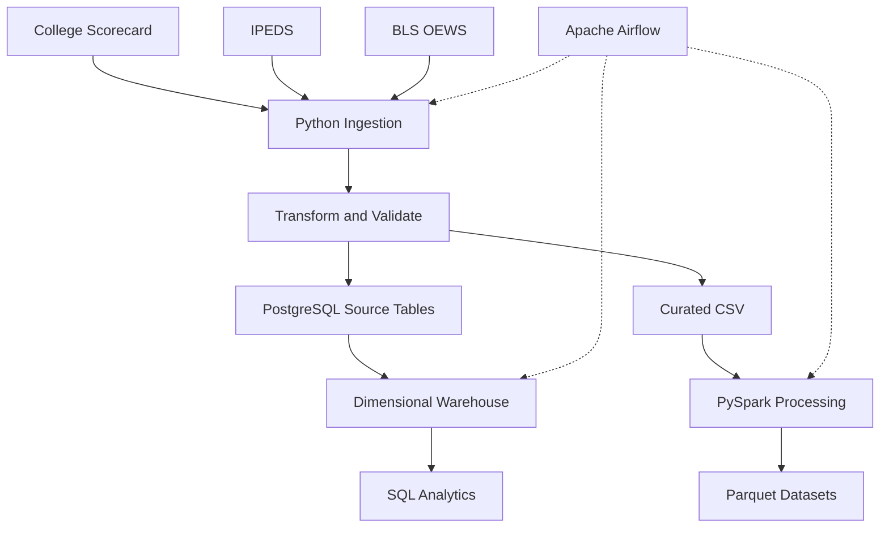

# EdAtlas — Higher Education Data Engineering Pipeline

EdAtlas is an end-to-end data engineering project integrating U.S. higher education and labor-market data from College Scorecard, IPEDS, and BLS OEWS.

The system uses Python for ingestion and transformation, Apache Spark for validated Parquet processing, PostgreSQL for dimensional data warehousing, and Apache Airflow for workflow orchestration.

## Project Highlights

| Metric | Verified Result |
|---|---:|
| Government data sources | 3 |
| Processed datasets | 7 |
| Records across datasets | 347,607 |
| Warehouse dimension tables | 5 |
| Warehouse fact tables | 4 |
| Automated tests | 86 passed |
| Full-refresh Airflow tasks | 12 successful |

## Technology Stack

Python 3.12 · pandas · PySpark · PostgreSQL 17 · Apache Airflow · SQLAlchemy · psycopg · Docker · pytest · uv

## Pipeline Architecture



## Key Features

- Retrieves paginated institution records through the College Scorecard API.
- Verifies API-reported record totals and unique school identifiers.
- Cleans and normalizes 14 source fields using pandas.
- Produces curated datasets with derived admission and completion percentages.
- Validates required fields, duplicate identifiers, numeric ranges, and source-data anomalies.
- Uses transactional staging and refresh operations to load PostgreSQL.
- Supports both live API ingestion and local JSON processing.
- Provides SQL analytics for institutions by state, net prices, and earnings-to-price comparisons.
- Includes automated tests for transformation, curation, validation, and transaction rollback behavior.

## Project Structure

- `dags/` — Airflow orchestration workflows
- `src/edatlas/ingestion/` — College Scorecard, IPEDS, and BLS ingestion
- `src/edatlas/transformation/` — Data cleaning and transformation
- `src/edatlas/loading/` — PostgreSQL source-table loaders
- `src/edatlas/quality/` — Data quality checks
- `src/edatlas/processing/` — PySpark processing and validation
- `src/edatlas/warehouse/` — Dimensional warehouse builder
- `sql/` — Analytics, schema definitions, and reconciliation
- `tests/` — Automated tests
- `data/` — Local datasets (not committed)

## Installation

Requirements:

- Python 3.12 or newer
- Java 17 for the verified local Spark environment
- uv package manager
- Apache Spark / PySpark and Apache Airflow for their respective workflows
- PostgreSQL 17 (locally or through Docker)
- College Scorecard API key

Install dependencies:

```bash
uv sync --frozen
```

Copy `.env.example` to `.env` and provide the appropriate API key and PostgreSQL connection settings.

The destination PostgreSQL table and database must already be initialized with the expected schema.

## Running the Pipeline

For live API ingestion, set:

```text
EDATLAS_USE_LOCAL_DATA=0
```

For local JSON input, set:

```text
EDATLAS_USE_LOCAL_DATA=1
```

Then execute:

```bash
uv run python -m edatlas.pipeline
```

The local mode requires an existing raw JSON dataset.

## Spark V2 Processing

Run after preparing the required source CSV datasets:

```bash
uv run --frozen python -m edatlas.processing.spark_pipeline_v2
```

The pipeline validates and publishes seven Parquet datasets using staged writes and backup recovery.

## Testing

Run the full test suite:

```bash
uv run --frozen pytest -q
```

The latest verified test run passed all 86 tests, including Parquet reliability, warehouse, and Airflow DAG tests.

## Dimensional Warehouse

The PostgreSQL `dw` schema contains five dimensions and four fact tables, plus the `vw_institution_overview` analytical view.

Warehouse implementation: `src/edatlas/warehouse/build.py`.

SQL definitions and reconciliation checks: `sql/09_build_warehouse.sql` and `sql/10_check_warehouse.sql`.

**Warning:** The local warehouse build recreates the `dw` schema. Do not run it against a database containing irreplaceable data.

## Airflow Orchestration

The `dags/` directory includes `edatlas_pipeline.py` (four tasks) and `edatlas_full_refresh.py` (twelve tasks).

Both DAGs support manual triggering. The full-refresh workflow successfully completed all twelve tasks in the verified local environment.

Airflow requires a separately configured environment with access to the project, source data, and PostgreSQL database.

## SQL Analytics

The `sql/` directory contains analytics, cross-source joins, database definitions, warehouse construction, and reconciliation queries. Key scripts include:

1. `01_colleges_by_state.sql` — Institution distribution by state.
2. `02_average_net_price_by_state.sql` — Average reported net prices by state.
3. `03_earnings_price_comparison.sql` — Descriptive earnings-to-price comparison.
4. `04_college_scorecard_ipeds_join.sql` — Cross-source institution joins.
5. `09_build_warehouse.sql` — Dimensional warehouse construction.
6. `10_check_warehouse.sql` — Warehouse reconciliation checks.

The earnings-to-price ratio is not a formal return-on-investment measure.

## Known Limitations

- Some source data fields contain missing or unusual values.
- Database initialization is not yet automated.
- Retries, backoff, and API resilience can be improved.
- Continuous integration and automated deployment are future improvements.
- The verified deployment runs locally; production cloud deployment has not been demonstrated.
- Parquet publication handles tested failures but is not crash-proof or safe for concurrent writers.
- Airflow full refresh is manually triggered, and the warehouse build recreates the `dw` schema.

## Data Sources

1. **College Scorecard** — U.S. Department of Education institution and outcome data. https://collegescorecard.ed.gov/data/

2. **IPEDS** — Institution characteristics, enrollment, and completions data. https://nces.ed.gov/ipeds/

3. **BLS OEWS** — Occupational employment and wage estimates. https://www.bls.gov/oes/

## Purpose

This project demonstrates practical data engineering skills in API ingestion, ETL development, data quality validation, relational databases, transaction handling, SQL analytics, and automated testing.