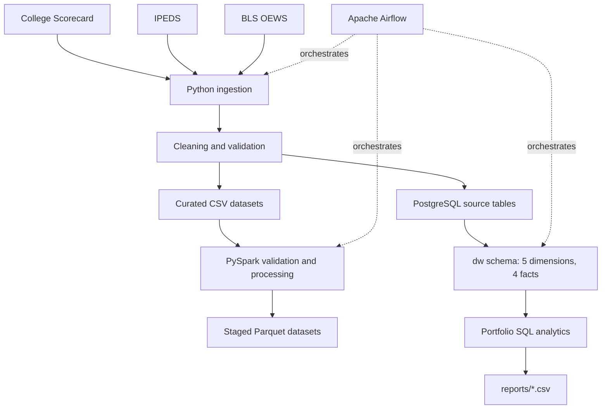

# EdAtlas — Higher Education Data Engineering Pipeline

[](https://github.com/tanishmishra2025-stack/EdAtlas/actions/workflows/ci.yml)

EdAtlas is an end-to-end data engineering portfolio project that integrates U.S. higher education and labor-market data from **College Scorecard**, **IPEDS**, and **BLS Occupational Employment and Wage Statistics (OEWS)**.

It uses Python for ingestion and transformation, PySpark for validated Parquet publication, PostgreSQL for a dimensional analytics warehouse, and Apache Airflow for orchestration. The project emphasizes data validation, reconciliation, reproducibility, and clear documentation of limitations.

## Project Highlights

| Metric | Verified result |
|---|---:|
| Government data sources | 3 |
| Processed datasets | 7 |
| Aggregate records across processed datasets | 347,607 |
| PostgreSQL warehouse dimensions | 5 |
| PostgreSQL warehouse fact tables | 4 |
| Warehouse analytical views | 1 |
| Previously verified full test suite | 86 passed |
| Clean-clone selected test suite | 62 passed |
| Airflow full-refresh tasks in verified local run | 12 successful |
| Portfolio analytical queries | 5 |
| Additional portfolio reconciliation query | 1 |

> **Counting note:** The 347,607 figure is the sum of records across seven processed datasets, **not** a count of unique students or institutions. The 86-test result is from the previously verified full suite; the subsequent clean-clone check ran a selected 62-test subset. A separate read-only transaction test also passed locally and was not part of the committed clean clone at the time of that check.

## Technology Stack

**Python 3.12**, pandas, **PySpark**, Parquet, **PostgreSQL 17**, SQLAlchemy, psycopg, **Apache Airflow**, Docker Desktop, pytest, and **uv**.

## Quickstart (Python environment and published reports)

```bash
git clone https://github.com/tanishmishra2025-stack/EdAtlas.git
cd EdAtlas
uv sync --frozen
cp .env.example .env
```

The committed results in [`reports/`](reports/) can be inspected **without PostgreSQL**. To rerun queries against **your own populated database**, edit `.env` with your PostgreSQL connection and run:

```bash
uv run --frozen python scripts/run_sql.py sql/portfolio/01_institutions_by_state.sql
```

A fresh clone does **not** include a running database, raw source files, or an empty-database bootstrap. The SQL runner requires an existing warehouse. **Do not run `python -m edatlas.warehouse.build` as a setup shortcut:** it drops and recreates the `dw` schema, and also requires the upstream source tables. Details and prerequisites appear under [Installation and Local Setup](#installation-and-local-setup).

## Pipeline Architecture



**Data flow:** Ingestion and cleaning prepare the data; PostgreSQL source tables feed the dimensional warehouse, while curated CSV files feed the PySpark/Parquet processing path. Airflow coordinates the configured workflows.

## Key Engineering Features

- **Three public data sources:** College Scorecard API ingestion; IPEDS institution, 2024 enrollment, and 2024 completions processing; and 2025 BLS OEWS state occupation-wage data.
- **Dimensional warehouse:** Five dimensions, four facts, and one analytical view in PostgreSQL's `dw` schema; explicit keys and fact-table grains.
- **PySpark and Parquet:** Seven staged, validated datasets, with backup-and-rollback handling for tested publication failures.
- **Airflow orchestration:** A full-refresh DAG with 12 tasks verified successful in the configured local environment.
- **Quality and reconciliation:** Enrollment counts constrained at the database level; program awards reconcile with institution totals across **19,384** groups, with **zero unmatched or mismatched groups**.
- **Reviewable analytics:** Five SQL analyses, one validation query, a read-only SQL runner, and six committed CSV output snapshots.

## Data Sources and Vintages

| Source | Data used | Vintage / reporting period | Reference |
|---|---|---|---|
| College Scorecard | Institution attributes and outcomes, including net price and completion rate | **Loaded snapshot; exact release/year needs to be recorded** | [U.S. Department of Education](https://collegescorecard.ed.gov/data/) |
| IPEDS | Institution characteristics, enrollment, and completions | **2024** for the loaded enrollment and completions datasets | [NCES IPEDS](https://nces.ed.gov/ipeds/) |
| BLS OEWS | State-level occupational employment and annual wages | **2025** in the loaded warehouse data | [BLS OEWS](https://www.bls.gov/oes/) |

The datasets describe different subjects and reporting periods. Cross-source comparisons are descriptive and should not be interpreted as causal relationships. The exact College Scorecard release is not established in this README; it should be recorded from ingestion metadata before publication as a specific vintage.

### Processed dataset breakdown

The **347,607** aggregate-record count is the sum of these seven distinct outputs; it is not a deduplicated count of institutions, students, or people.

| Processed dataset | Records |
|---|---:|
| College Scorecard processed | 6,273 |
| College Scorecard curated | 6,273 |
| IPEDS institutions | 6,072 |
| IPEDS 2024 enrollment | 5,842 |
| IPEDS 2024 completions, program records | 267,595 |
| IPEDS 2024 institution/award-level completion totals | 19,384 |
| BLS OEWS 2025 state occupation wages | 36,168 |
| **Sum of rows across outputs** | **347,607** |

## Repository Structure

```text
dags/                         Airflow DAG definitions
src/edatlas/ingestion/         Source ingestion
src/edatlas/transformation/    Cleaning and transformation
src/edatlas/loading/           PostgreSQL source-table loaders
src/edatlas/quality/           Data-quality checks
src/edatlas/processing/        PySpark and Parquet processing
src/edatlas/warehouse/         Warehouse build and validation
sql/                           Source and warehouse SQL
sql/portfolio/                 Five analytics + reconciliation query
scripts/run_sql.py             Read-only SQL runner and CSV exporter
reports/                       Committed portfolio query outputs
tests/                         Automated tests
data/                          Local data (not committed)
.env.example                   Placeholder environment configuration
```

## Installation and Local Setup

### Prerequisites

- Python 3.12 (the verified local environment uses Python 3.12)
- [uv](https://docs.astral.sh/uv/) package manager
- Java 17 for the verified local Spark setup
- PostgreSQL 17, running locally or in Docker
- A College Scorecard API key **for live API ingestion**
- Apache Airflow configured separately **if running DAGs**

Clone the repository and install its pinned Python dependencies:

```bash
git clone https://github.com/tanishmishra2025-stack/EdAtlas.git
cd EdAtlas
uv sync --frozen
```

Create a local environment configuration file:

```bash
cp .env.example .env
```

Edit `.env` and set:

| Setting | Purpose |
|---|---|
| `COLLEGE_SCORECARD_API_KEY` | Required for live College Scorecard API requests |
| `EDATLAS_DATABASE_URL` | SQLAlchemy-compatible PostgreSQL connection URL |
| `EDATLAS_USE_LOCAL_DATA` | `0` = live College Scorecard API; `1` = existing local JSON data |

The `.env` file is excluded from Git. **Never commit API keys or database passwords.** The `.env.example` contains placeholders, not working credentials.

### Database and data prerequisites

A clean clone **does not** include source datasets or a prepopulated PostgreSQL database. Start and configure a separate PostgreSQL 17 instance and prepare the relevant source tables using the project's ingestion/loading workflows before building the analytics warehouse. There is **no committed Docker Compose setup or one-command, empty-database bootstrap** in the verified repository state.

> **Destructive-operation warning:** `src/edatlas/warehouse/build.py` executes `sql/09_build_warehouse.sql`, which **drops and recreates the `dw` schema**. Do not run a warehouse rebuild on a database whose current warehouse contents you need to preserve. The portfolio SQL queries below are read-only and do not require a rebuild when the warehouse is already populated.

### Verified clean-clone scope

A fresh WSL Ubuntu checkout successfully completed `uv sync --frozen` and a selected **62-test** suite. End-to-end loading from an empty PostgreSQL instance was **not** verified in that clean-clone check. Running the pipeline without a `.env` file stopped as expected because the live-mode API key was missing.

## Running the Pipeline

Choose a mode in `.env`:

```dotenv
# Live College Scorecard ingestion (requires a valid API key)
EDATLAS_USE_LOCAL_DATA=0
```

Or:

```dotenv
# Process an existing local College Scorecard raw JSON dataset
EDATLAS_USE_LOCAL_DATA=1
```

Then run:

```bash
uv run --frozen python -m edatlas.pipeline
```

**Prerequisites:** Local mode requires an existing raw JSON dataset in the location expected by the project; live mode requires a valid API key and network access. Pipeline loading requires the configured PostgreSQL database and applicable source schema. This is not a one-command demo on an empty clone.

### PySpark / Parquet processing

After preparing the required source CSV datasets and Java environment:

```bash
uv run --frozen python -m edatlas.processing.spark_pipeline_v2
```

The processing workflow validates and publishes **seven Parquet datasets** using staged writes, backup paths, and tested rollback behavior. Publication is **not** guaranteed to be crash-atomic and is not designed for concurrent writers.

## Dimensional Warehouse and Data Quality

The PostgreSQL **`dw` schema** contains five dimensions, four fact tables, and the `vw_institution_overview` analytical view.

- Warehouse definition: `sql/09_build_warehouse.sql`
- Warehouse reconciliation checks: `sql/10_check_warehouse.sql`
- Warehouse orchestration code: `src/edatlas/warehouse/build.py`

The outcomes fact table uses **one row per institution**, with `school_id` as its primary key. It does **not** contain an observation-year column, so its metrics represent the loaded Scorecard snapshot rather than a longitudinal series.

The enrollment fact table uses `(school_id, enrollment_year)` as its key and includes a database check that `male_enrollment + female_enrollment = total_enrollment`.

### Input validity and sentinel handling

Some College Scorecard outcomes are missing or outside the meaningful range. The published state-outcomes query excludes **negative net prices** from price averages and keeps only **completion rates from 0 through 1** for completion averages. Previous checks observed **12 negative net-price records** in the curated Scorecard data; these are excluded from this analysis rather than silently rewritten in the warehouse. A missing value is not treated as zero.

IPEDS enrollment includes a database constraint requiring `male_enrollment + female_enrollment = total_enrollment`. This checks the loaded records' arithmetic but does not guarantee that every institution reports enrollment or that source definitions are perfectly comparable.

### Verified completions reconciliation

The portfolio query `sql/portfolio/06_validate_completions.sql` compares summed program completions with loaded institutional completion totals by institution and award level.

| Check | Result |
|---|---:|
| Institution–award-level groups | 19,384 |
| Matched groups | 19,384 |
| Unmatched groups | 0 |
| Mismatched groups | 0 |
| Program-level reported awards summed | 5,459,862 |
| Institutional reported awards summed | 5,459,862 |

These figures count **reported awards**, not necessarily unique graduates. The reconciliation validates consistency between the two loaded representations; it does not independently verify the underlying source data.

## Portfolio SQL Analytics

Five analytical queries and one reconciliation query live in `sql/portfolio/`. The checked-in results are under `reports/`, allowing reviewers to inspect outputs without connecting to your database.

To rerun a query **against an existing, populated warehouse**:

```bash
uv run --frozen python scripts/run_sql.py sql/portfolio/01_institutions_by_state.sql
```

The runner prints the results and exports `reports/01_institutions_by_state.csv`. Substitute the SQL filename to execute another portfolio query.

The runner issues `SET TRANSACTION READ ONLY` within a PostgreSQL transaction. A local pytest test confirmed that PostgreSQL rejects a table `INSERT` under this transaction mode. The runner's simple `SELECT`/`WITH` prefix check is a convenience check, **not** a general-purpose SQL parser or security boundary. Use only trusted SQL files with a properly restricted database account.

### 1. Where are institutions located?

**Query:** [`sql/portfolio/01_institutions_by_state.sql`](sql/portfolio/01_institutions_by_state.sql)
**Result:** [`reports/01_institutions_by_state.csv`](reports/01_institutions_by_state.csv)
**Vintage:** Combined IPEDS/College Scorecard institution coverage; IPEDS institution snapshot loaded alongside 2024 data; exact Scorecard release unverified.

**Finding:** California led the returned top ten states with **721** institutions in the combined institution dimension: **668** represented in IPEDS and **666** represented in College Scorecard. Those source-specific counts overlap and should **not** be added together.

**Limitations:** The query ranks states by institutions in the loaded warehouse, not all institutions in the country. IPEDS and Scorecard use different coverage rules. This result is descriptive, not causal.

### 2. How do reported net prices and completion rates differ by state?

**Query:** [`sql/portfolio/02_state_outcomes.sql`](sql/portfolio/02_state_outcomes.sql)
**Result:** [`reports/02_state_outcomes.csv`](reports/02_state_outcomes.csv)
**Vintage:** Loaded College Scorecard outcomes snapshot; exact release unverified.

**Finding:** Among the ten states returned by the Scorecard-institution-count ranking, **Florida** had the highest unweighted average completion rate (**63.24%**), while **North Carolina** had the lowest unweighted average net price (**$14,730.67**). California had **666** institutions with an outcomes fact row, of which **499** had valid nonnegative net-price data and **490** had a completion rate in the range 0–1.

**Limitations:** Means are **unweighted institution-level averages**, exclude missing/invalid values, mix institution types, and may not describe the typical student. This top-ten list is not identical to Query 1's because it uses Scorecard coverage. The source snapshot has no outcome-year dimension; price and completion comparisons are not causal.

### 3. Which states have the most reported enrollment?

**Query:** [`sql/portfolio/03_enrollment_by_state.sql`](sql/portfolio/03_enrollment_by_state.sql)
**Result:** [`reports/03_enrollment_by_state.csv`](reports/03_enrollment_by_state.csv)
**Vintage:** IPEDS 2024 enrollment.

**Finding:** In the loaded **2024 IPEDS** enrollment data, **California** ranked first with **2,770,411** enrolled students across **628** reporting institutions, representing **13.61%** of enrollment summed across the loaded state-level records. The query demonstrates `RANK()` and a `SUM(...) OVER ()` denominator calculated before limiting results.

**Limitations:** The percentage describes **the loaded dataset**, not necessarily an independently verified nationwide census. Counts reflect the IPEDS enrollment reporting scope and year, and should not be directly equated with Scorecard institution counts.

### 4. How are reported awards distributed across IPEDS award levels?

**Query:** [`sql/portfolio/04_completions_by_award_level.sql`](sql/portfolio/04_completions_by_award_level.sql)
**Result:** [`reports/04_completions_by_award_level.csv`](reports/04_completions_by_award_level.csv)
**Vintage:** IPEDS 2024 completions.

**Finding:** Award-level **code 5** accounted for **1,974,834** reported awards, or **36.17%** of the **5,459,862** awards represented in the loaded 2024 completions data. All **19,384** institution–award-level groups reconciled with institutional totals.

**Limitations:** These are **award counts**, not unique students. The output retains IPEDS numeric award-level codes rather than asserting unverified labels. Only the loaded year is available, so there is no year-over-year claim.

### 5. How do technology occupation wages compare across states?

**Query:** [`sql/portfolio/05_technology_wages.sql`](sql/portfolio/05_technology_wages.sql)
**Result:** [`reports/05_technology_wages.csv`](reports/05_technology_wages.csv)
**Vintage:** Loaded BLS OEWS 2025 state-level data.

**Finding:** Among states with reported wages in the selected **2025 BLS OEWS** occupations, the highest median annual wage returned for **Software Developers** was **$174,410** (California); for **Data Scientists**, **$163,350** (Washington); and for **Database Administrators**, **$135,750** (Utah). The query uses occupation-partitioned wage rankings and excludes missing median wages from ranking.

**Limitations:** These are occupational estimates, **not job offers or entry-level salaries**. State wage estimates are not adjusted for cost of living, the occupations were intentionally selected, and missing/suppressed observations can affect rankings.

### 6. Do program awards reconcile with institutional totals?

**Validation query:** [`sql/portfolio/06_validate_completions.sql`](sql/portfolio/06_validate_completions.sql)
**Result:** [`reports/06_validate_completions.csv`](reports/06_validate_completions.csv)
**Vintage:** IPEDS 2024 completions.

**Finding:** **19,384 matching groups; zero mismatches or unmatched groups**, with **5,459,862** reported awards on both sides of the comparison.

**Limitations:** Agreement between two loaded representations does not establish that the underlying source is error-free.

## Testing

Run the suite with:

```bash
uv run --frozen pytest -q
```

**Verified test evidence:** The full suite previously passed **86 tests** in the configured local development environment. A fresh clone later passed **62 selected tests**, with database-dependent integration tests excluded. A new read-only PostgreSQL transaction test subsequently passed locally. Tests requiring PostgreSQL, local data, or Airflow configuration may require additional setup.

The tests cover source transformation, curation, data validation, selected database integrations, Parquet publication reliability, Spark processing checks, warehouse checks, and Airflow DAG definitions.

## Airflow Orchestration

The repository includes two DAG definitions:

| DAG file | Tasks | Verified status |
|---|---:|---|
| `dags/edatlas_pipeline.py` | 4 | Executed in the configured local environment |
| `dags/edatlas_full_refresh.py` | 12 | All 12 tasks successful in a verified local run |

Airflow uses a separately configured environment, with access to project files, source data, and PostgreSQL. The full-refresh DAG **rebuilds warehouse data**; do not trigger it against a database you want to preserve.

Airflow run screenshots are not included yet; the task counts above come from the verified local run, not an embedded image.

## Design Decisions and Tradeoffs

- **Why PySpark for this data size?** The seven processed datasets total about **347,607 records**, which can often be handled with pandas on one computer. PySpark was included to demonstrate distributed-style DataFrame validation and Parquet workflows relevant to Data Engineering roles, **not** because the observed volume required a cluster. This trades simpler deployment for skills demonstration and future scalability.
- **How is IPEDS–Scorecard overlap handled?** The institution dimension tracks `in_ipeds` and `in_scorecard` separately; counts from both sources overlap and are never added together as if disjoint. The Scorecard outcomes fact is keyed by `school_id`, so outcome analyses count Scorecard-covered institutions rather than all institutions in the dimension.
- **Why staged writes and transactions?** Database loading uses transactions to avoid partially committed refreshes; Parquet publishing stages outputs and retains a backup for tested rollback scenarios. These are practical safeguards, **not** a claim of atomic multi-system updates or recovery from every process crash.
- **Why PostgreSQL dimensional modeling?** Separate facts and dimensions support consistent SQL joins, state and institution analyses, and explicit grain. This adds modeling and load complexity compared with directly querying source CSV files.
- **Why retain CSV and Parquet outputs?** CSV supports easy inspection and interchange; Parquet supports typed columnar storage and Spark workflows. Keeping both incurs additional storage and processing steps.
- **Why publish CSV query outputs?** Reviewers can inspect real query results without access to a running database. Exports are snapshots and can become stale as the inputs change.
- **Why prioritize local reproducibility?** This is a verified local engineering portfolio, not a demonstrated production cloud deployment. Automated clean-database provisioning, broader retries/backoff, and production operations are outside the completed scope.

## Known Limitations

- The **exact College Scorecard release vintage** is not yet recorded in project documentation.
- Some source fields are missing, suppressed, or contain unusual values; each portfolio analysis specifies its relevant exclusions and caveats.
- The top-ten institution and Scorecard-outcome analyses use **different ranking populations**, so their state lists differ.
- The full database cannot be reconstructed from the Git repository alone: raw inputs, PostgreSQL initialization, and some external setup are required.
- The warehouse build recreates `dw`; it is not an incremental, nondestructive refresh.
- Parquet publication has tested rollback/recovery paths but is not fully crash-atomic or safe for concurrent writers.
- Airflow runs were verified locally, not in a production cloud deployment.
- GitHub Actions CI and an Airflow screenshot are **planned final portfolio presentation tasks**, not represented here as completed.

## Purpose

EdAtlas demonstrates practical Python and Data Engineering skills: multi-source ingestion, data cleaning, quality validation, PySpark/Parquet processing, PostgreSQL warehouse modeling, analytical SQL (joins, CTEs, aggregates, and window functions), workflow orchestration, automated tests, and reconciliation of independently loaded data representations.

**Repository:** [github.com/tanishmishra2025-stack/EdAtlas](https://github.com/tanishmishra2025-stack/EdAtlas)
